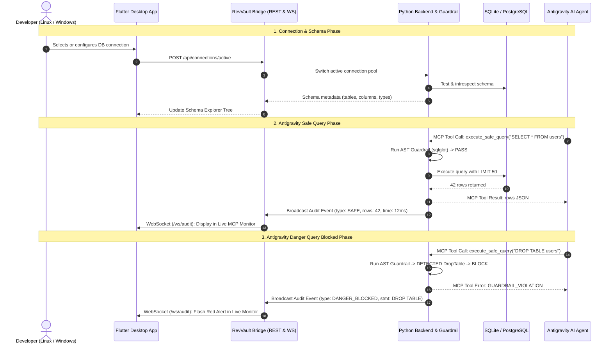

# RevVault — The Bridge Specification (IPC, Networking & Protocol Sync)

> **Company**: Relva  
> **Product**: RevVault  
> **Scope**: Inter-Process Communication (IPC), State Synchronization & Real-time Telemetry

---

## 1. Bridge Architecture Overview

The **Bridge** connects three distinct runtimes into a unified, secure database platform:
1. **The Antigravity AI Agent** (operating via the Model Context Protocol).
2. **The Python Backend & Engine** (handling AST guardrails, connection pooling, and introspection).
3. **The Flutter Desktop Application** (rendering the user interface for developers on Linux & Windows).



---

## 2. Communication Protocols & Contracts

### 2.1 Flutter <-> Python Backend (REST API)
- Standard HTTP/1.1 JSON-RPC/REST over `localhost:8000`.
- Fast, low-latency loopback communication.
- Endpoints enforce typed request/response models via Pydantic on Python and Dart data classes in Flutter.

### 2.2 Real-time Telemetry (WebSocket Bridge)
- Path: `ws://127.0.0.1:8000/ws/audit`
- Flutter establishes a persistent WebSocket connection upon startup.
- Every event triggered through Antigravity MCP or the local SQL editor is broadcast to the WebSocket channel:
  ```json
  {
    "event_id": "evt_9823f4a1",
    "timestamp": "2026-09-30T07:45:12.102Z",
    "source": "ANTIGRAVITY_MCP",
    "action": "execute_safe_query",
    "sql": "SELECT id, username FROM users",
    "status": "ALLOWED",
    "execution_time_ms": 14.2,
    "row_count": 50,
    "blocked_reason": null
  }
  ```
  If blocked:
  ```json
  {
    "event_id": "evt_9823f4a2",
    "timestamp": "2026-09-30T07:45:33.411Z",
    "source": "ANTIGRAVITY_MCP",
    "action": "execute_safe_query",
    "sql": "DROP TABLE accounts",
    "status": "BLOCKED",
    "execution_time_ms": 1.1,
    "row_count": 0,
    "blocked_reason": "Disallowed AST node 'DropTable'. Modifying DDL is forbidden."
  }
  ```

---

## 3. Storage & Configuration Bridge

Both the Python backend (and standalone MCP stdio process) and the Flutter UI share a standardized, user-level state repository:
- **Location**:
  - Linux: `~/.revvault/`
  - Windows: `%APPDATA%\Relva\RevVault\` or `~/.revvault/`
- **Files**:
  - `connections.json`: List of configured database profiles, engine types, hosts, ports, paths.
  - `guardrail_rules.json`: Custom security policies (e.g., maximum allowed row limits, custom blocked keyword overrides).
  - `audit_history.sqlite`: Local persistent log of all previous queries and security events.

---

## 4. Lifecycle & Process Management Modes

### Mode 1: Integrated Sidecar Mode
- When the developer launches the **RevVault Flutter App**, Flutter checks if the backend port (default `8000`) is active.
- If not running, Flutter spawns the Python backend as a background sidecar process:
  ```dart
  Process.start('python3', ['backend/run_server.py'], mode: ProcessStartMode.detached);
  ```
- When Flutter exits, it cleanly signals the sidecar process to terminate.

### Mode 2: Headless / Daemon Mode
- The Python backend runs as a continuous system service (systemd service on Linux, Windows background service, or launched manually in a terminal).
- Antigravity and the Flutter app independently connect to it via `localhost:8000`.
- Best for persistent developer workstations and remote database proxies.
